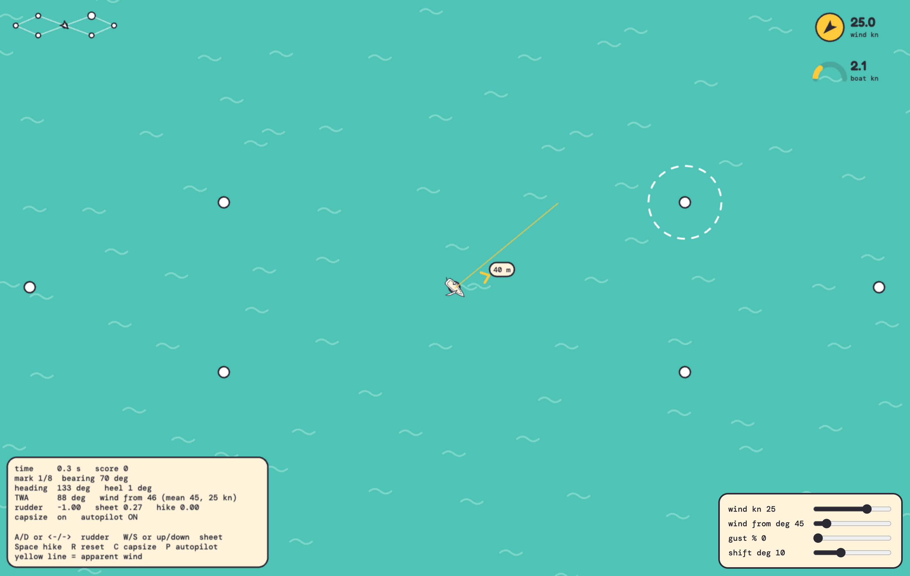
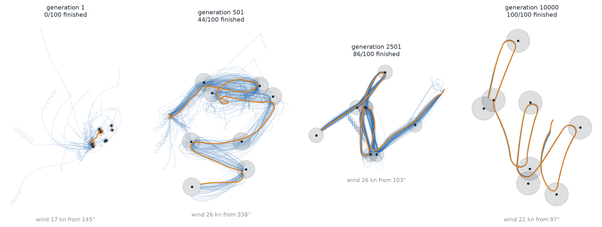
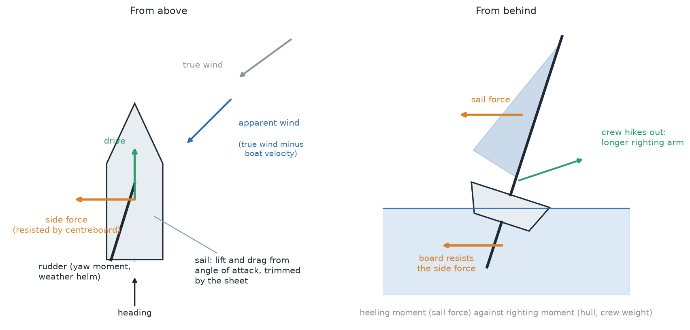
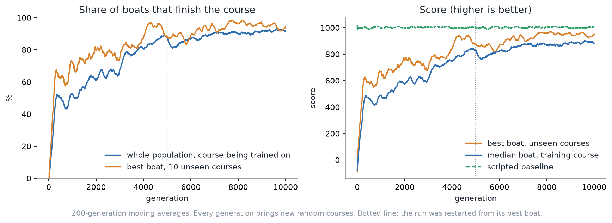
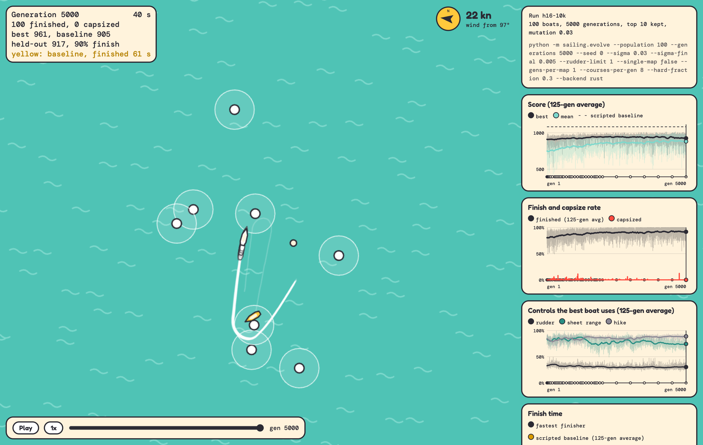

# Sailing game

A small sailing simulator in Rust where neural-net sailors learn to race a course by evolution. A viewer in `web/` replays every boat of every checkpoint generation as ghosts with wakes.

## Play it yourself

You can sail the boat yourself in the browser, on the same physics the neural nets use. You steer, trim the sheet and hike out, round the marks in order, and try to beat the clock. The wind, its direction, gusts and wind shifts have sliders.



| Key | Action |
|---|---|
| `A` / `D` or `←` / `→` | rudder |
| `W` / `S` or `↑` / `↓` | trim the sheet in / ease it out |
| `Space` or `Shift` (hold) | hike: lean out to keep the boat flat |
| `P` | hand over to the scripted autopilot (or open with `?auto=1`) |
| `C` | capsizing on or off |
| `R` | restart |

The yellow line is the apparent wind, the arrow around the boat points to the next mark, and the ring shows heel. Run it from `web/` with `npm install` and `npm run dev` (it builds the Rust core to WebAssembly first, so you need the `wasm32-unknown-unknown` target and `wasm-bindgen`), then open the address Vite prints. The trained boats are not playable in the browser yet. They are replayed on the Training page (`/training.html`), and the autopilot there is the hand-written baseline.



*The same population at generations 1, 501, 2501 and 10000, each on its own random course. Blue: all 100 boats. Orange: the best one. Grey circles: the marks.*

## What it does

- Each boat is a 16-unit network that reads 34 inputs (boat state, and every mark still to round) and outputs rudder, sheet and hike (leaning out).
- Every generation all 100 boats sail the same 8 freshly drawn random courses (8 legs each), each in its own random wind (8 to 16 m/s, any direction), and a boat is scored on its mean. The best 10 % carry over unchanged and the rest are mutated copies of the best 30 %. The run is 10,000 generations, so 80,000 courses. It was trained in two stretches of 5,000: the second restarted from the best boat of the first (see the step size below).
- Score rewards progress, mark bonuses and a fast finish, and charges a time cost and a capsize penalty. The rudder has its full deflection (`--rudder-limit` can cap it).

## The boat

The simulator is a deterministic Rust core (`crates/sailsim`) for a single-handed ILCA/Laser-class dinghy: 4.2 m long, 7 m² sail, 160 kg with the sailor. It is 2D (position, heading, surge and sway speed, yaw rate) plus heel angle, stepped with a fixed-step RK4 integrator. The same code runs in training (via PyO3) and in the browser (via WASM).



*A sketch of what the simulator models, not output from it.*

- **Apparent wind:** the true wind minus the boat's own velocity, in the boat's frame. It swings forward as the boat speeds up.
- **Sail:** lift and drag from the angle of attack, with stall. The sheet sets the boom angle. The force acts at the sail's centre of effort, which gives the heeling moment. Once that moment is large the sail depowers (flattens), as a sailor would.
- **Hull:** drag that follows a tank-test table, with its hump near 6.5 kn. There is no planing.
- **Centreboard and rudder:** foils with lift and drag. The board resists sideways force, so leeway is small but not zero. The rudder is at the stern, so spinning and sideslip change what it sees. The board sits ahead of the sail's centre of effort, so a released rudder rounds the boat up (weather helm).
- **Heel:** a righting moment from a hiking-crew curve. Past 70° of heel the boat capsizes and the run ends.
- **Controls:** rudder, sheet and hike (how far the sailor leans out). These are the three network outputs.

At 12 kn of wind the model gives about 5.3 kn and a VMG of 3.4 kn at 46° close-hauled, and 6.8 kn on a beam reach. Published figures for the class are 5.4 kn, 3.75 kn and 6.5 kn. Light-air VMG is about 20 % low. Several parameters are tuned without a source and the design doc lists them: [`docs/plans/2026-10-14-dinghy-sim-design.md`](docs/plans/2026-10-14-dinghy-sim-design.md), with the source check in [`docs/research/`](docs/research/2026-10-14-dinghy-physics-validation.md). There are no waves, gusts or wind shifts in these runs.

## How it learns

There is no gradient and no value function. The learner is a plain evolution strategy (neuroevolution) over the weights of a fixed network, so the only learning signal is the episode score.

- **Policy:** 34 inputs (9 for the boat and wind, 3 for each of the 8 marks still to round, and how many are left), 16 tanh hidden units, 3 tanh outputs (rudder, sheet, hike). That is 611 numbers, stored as one flat vector per boat.
- **Fitness:** the total `sailcourse` score of one episode (progress, mark bonuses, a finish bonus for speed, a time cost, a capsize penalty). Every boat in a generation sails the same courses and winds, so they are ranked on equal terms. A boat's fitness is its mean over the generation's 8 courses, and 30 % of the training legs are sharp reversals or close to the wind.
- **Selection:** rank the 100 boats by score. The top 10 (elitism) carry over unchanged. The other 90 are copies of boats picked at random from the top 30, each with Gaussian noise added to every weight.
- **Step size:** the noise starts at σ = 0.1 and shrinks linearly to 0.01 over the first 5,000 generations. The second 5,000 start again from the best boat of the first (a new population of mutated copies of it) with σ = 0.03 shrinking to 0.005, to polish. Same seed both times.
- **New courses every generation:** the elite are re-scored on each new set of courses, so a boat only stays on top if it holds up on the next ones.
- **Held-out check:** each generation the best boat also sails 10 fixed unseen courses and the old figure 8. This is the generalisation curve in the results below.

```
random weights ─► sail the courses ─► score ─► keep top 10, mutate top 30 ─► next generation
        ▲                                                                           │
        └────────────── new courses and winds every generation ◄───────────────────┘
```

The loop is `python/sailing/evolve.py`. Episodes run in parallel across processes through a Gymnasium environment (`python/sailing/env.py`) over the same Rust code as the game. A scripted baseline sailor, not trained, is the reference the scores are compared with.

## Results





*The game's Training page at the last generation (10000, which the page shows as generation 5000 of the second stretch), 40 s into the run: the 100 boats with wakes, rounding the marks (by now they sail almost the same line, so they overlap), and the training graphs on the right. Open it yourself with `/training.html?run=h16-10k&gen=5000&t=40` (the first stretch is `run=h16-5k`).*

| Generations | Finish rate (training courses) | Finish rate (best boat, unseen courses) | Score (best boat, unseen courses) |
|---|---|---|---|
| 1 to 2000 | 52 % | 68 % | 631 |
| 2001 to 4000 | 72 % | 81 % | 761 |
| 4001 to 6000 | 85 % | 91 % | 883 |
| 6001 to 8000 | 89 % | 94 % | 927 |
| 8001 to 10000 | 91 % | 95 % | 951 |

- Over the last 500 generations about 92 % of the population finishes the courses it is trained on and the best boat finishes about 93 % of courses it has never seen. It almost never capsizes (about 2 % of boats in the first 2000 generations, 0.01 % in the last 2000).
- The score on unseen courses climbs from about 570 (first 1000 generations) to about 950 and levels off near 950 over the last 2000 generations.
- At generation 5001 the run restarts from the best boat, so the population finish rate drops for about a thousand generations (the dotted line in the graphs) before it passes its old level.
- It does not yet beat the scripted baseline. The baseline scores about 1000 on a typical course, the best evolved boat about 940 on unseen ones.
- The best boat finishes the old figure 8 every time in the last 500 generations.

## Run it

```sh
cd python
.venv/bin/python -m sailing.evolve --out ../web/public/runs/h16-5k \
    --generations 5000 --population 100 --sigma 0.1 --sigma-final 0.01 \
    --hidden 16 --courses-per-gen 8 --hard-fraction 0.3
.venv/bin/python -m sailing.evolve --out ../web/public/runs/h16-10k \
    --init-from ../web/public/runs/h16-5k/best.json \
    --generations 5000 --population 100 --sigma 0.03 --sigma-final 0.005 \
    --hidden 16 --courses-per-gen 8 --hard-fraction 0.3
```

On 8 cores this takes a while (each 5,000-generation stretch). Then, in `web/`, `npm run dev` and open `/training.html`. See `python/README.md` for the options.

Regenerate the figures above from the finished runs (the runs are drawn as one, in order):

```sh
.venv/bin/python python/scripts/readme_figures.py web/public/runs/h16-5k web/public/runs/h16-10k docs/img
```

`docs/img/midrun.png` is a screenshot of the page itself (with `npx vite` running in `web/`):

```sh
"/Applications/Google Chrome.app/Contents/MacOS/Google Chrome" --headless=new --use-angle=swiftshader --enable-unsafe-swiftshader \
    --force-device-scale-factor=2 --window-size=1500,950 --virtual-time-budget=15000 \
    --screenshot=docs/img/midrun.png "http://localhost:5173/training.html?run=h16-10k&gen=5000&t=40"
```

## License

[MIT](LICENSE)
