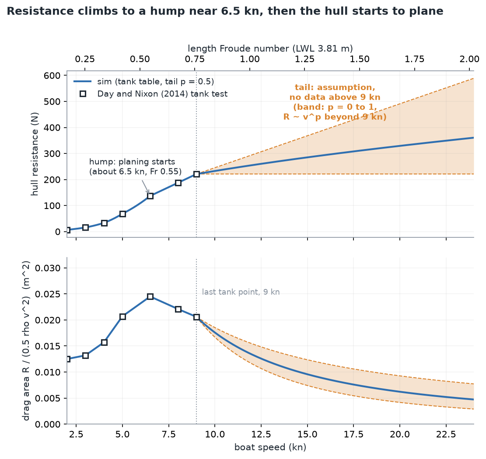
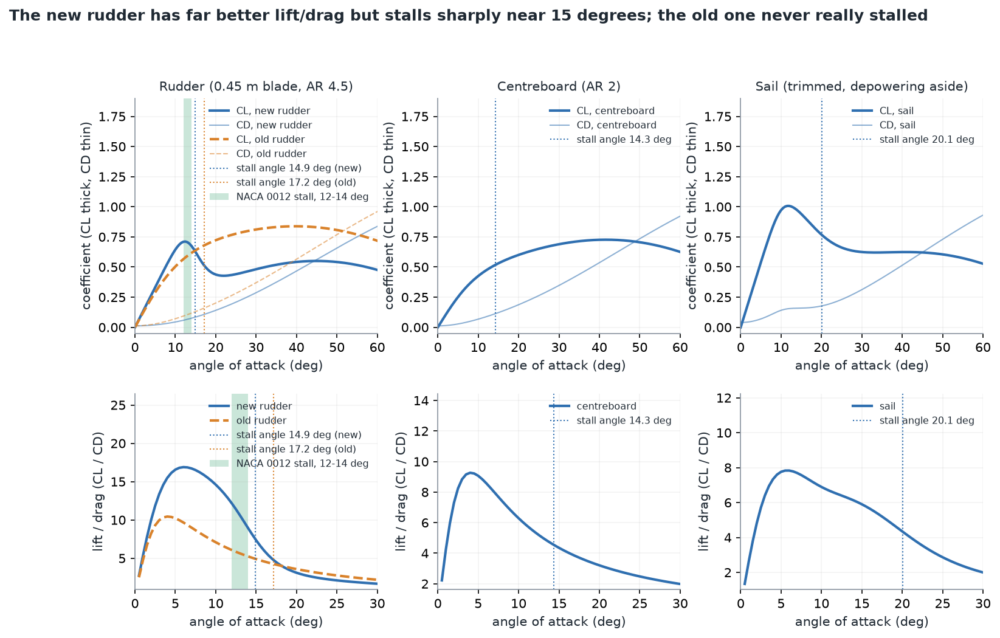
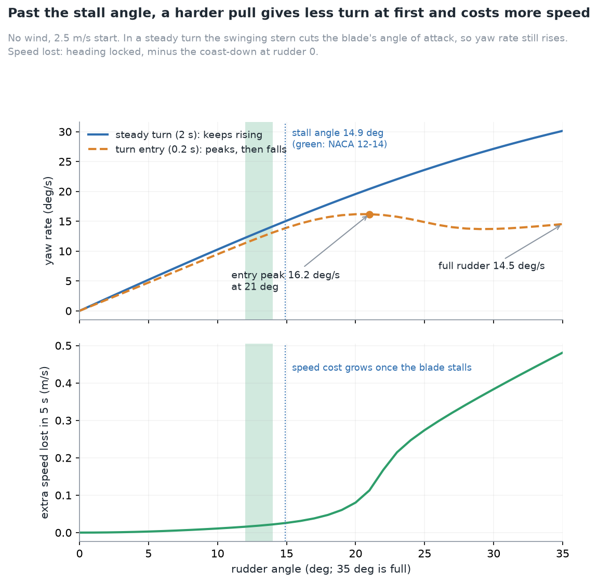
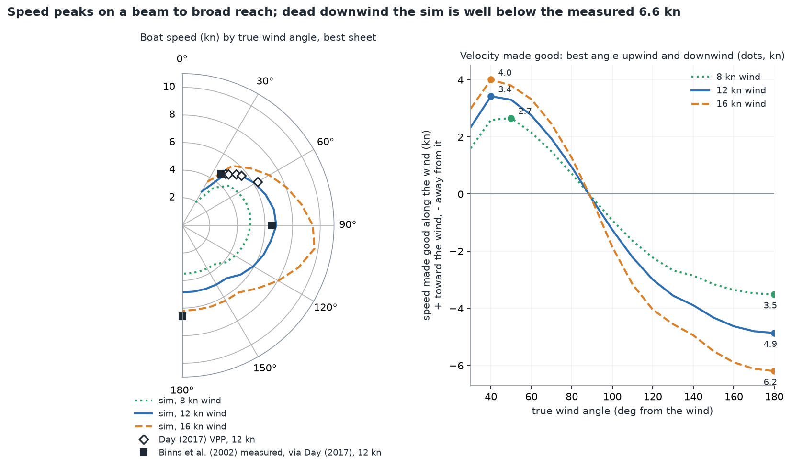
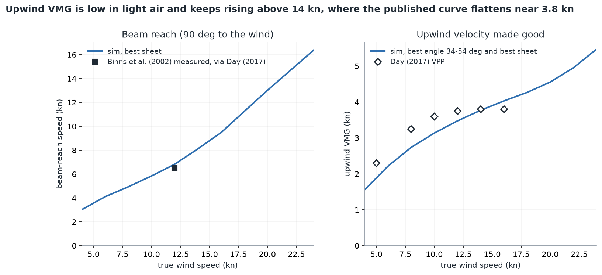
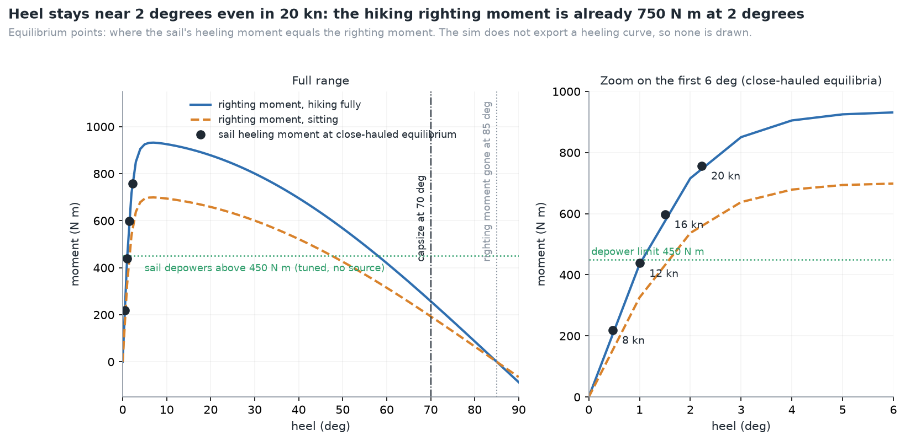
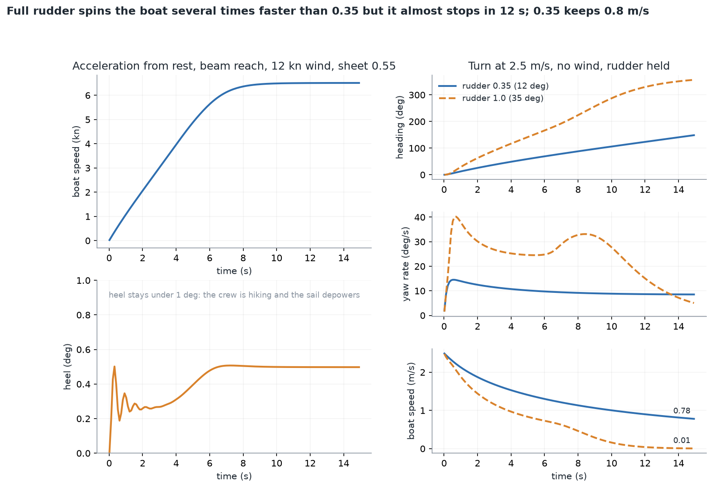

# How the boat behaves: seven graphs from the simulator

Every curve below is computed by the Rust sim itself (`crates/sailsim/examples/dynamics_data.rs` writes the numbers, `python/scripts/dynamics_figures.py` draws them). Nothing is a sketch. Where a published measurement or a published model result exists it is drawn as a marker with its source in the legend. The sources are quoted in [`research/2026-10-14-dinghy-physics-validation.md`](research/2026-10-14-dinghy-physics-validation.md) and [`research/2026-10-18-parameter-audit.md`](research/2026-10-18-parameter-audit.md).

To redraw them:

```
cargo run --release -p sailsim --example dynamics_data -- /tmp/dyn
python python/scripts/dynamics_figures.py /tmp/dyn docs/img/dynamics
```

The data run takes about 11 s in release mode. Polars and speed-against-wind use a 90 s locked-heading run per sheet setting (21 settings), averaged over the last 30 s, with the best sheet picked for each wind angle (best VMG close-hauled, best speed otherwise) and the crew hiking fully. Close-hauled grids are coarse (10 degrees in the polar, 2 degrees in the wind sweep), so best angles are good to about 2 degrees.

What is sourced and what is not: the hull curve up to 9 kn, the rudder slope, efficiency and stall angle, the righting-moment size and the published overlay points are sourced. The hull resistance above 9 kn (figure 1), the sail's depower moment, the tuned boom angle, and the inertias and damping that shape figure 7 (yaw inertia 200 kg m^2, yaw damping 80 and 60, roll inertia 250 kg m^2, roll damping 900) are assumptions or tuned values with no source.

## 1. Hull resistance and the hump



Look at the lower panel: drag area (resistance divided by dynamic pressure) rises to a hump at 6.5 kn and then falls, which is the hull starting to plane. The sim follows the Day and Nixon (2014) tank-test points exactly up to 9 kn. For a sailor it means the boat has a speed barrier near 6.5 kn that only a good gust or a reach gets it through; once through, resistance grows much more slowly than speed squared.

Above 9 kn there is no tank data. The shaded band shows what the assumed power law `R = R9 (v / 9 kn)^p` gives for p = 0 (flat resistance) to p = 1; the sim uses p = 0.5. Treat that tail as an assumption, low confidence. It decides how fast the boat gets on a reach in 20 kn or more.

## 2. Foil lift and drag



Top row: lift (thick) and drag (thin) coefficients against angle of attack. Bottom row: lift divided by drag, which is how efficiently the foil makes sideways force. The new rudder (slope 3.8 per radian, aspect ratio 4.5, efficiency 0.97, from Day 2017) is far more efficient than the old one, with a peak lift-to-drag near 17 against 10, and it stalls abruptly at 14.9 degrees (green band: NACA 0012 stalls at 12 to 14 degrees). The old rudder had a soft, broad lift maximum and never really stalled.

For sailing: a rudder held at more than about 15 degrees of blade angle loses lift and adds drag, so a hard pull on the tiller turns the boat less than expected. Board and sail stall angles are model values; the sail's lift ceiling and depowering are tuned (see figure 6).

## 3. What the rudder does



Two yaw-rate curves are shown on purpose. On turn entry (0.2 s after the helm goes over, orange) the yaw rate peaks at about 16 deg/s near 21 degrees of rudder and falls to 14.5 deg/s at full rudder: the stalled blade really does give less turn. In a steady turn (2 s, blue) the yaw rate rises all the way to full rudder. The reason is that once the boat is swinging, the stern moves sideways and that cuts the blade's angle of attack by roughly 20 degrees, so the blade is no longer stalled. This is by design (see the Retune log in the plan).

The lower panel is the price: with the heading held, speed lost beyond the ordinary coast-down grows quickly once the blade is stalled, about 0.5 m/s over 5 s at full rudder. For sailing: use the rudder moderately, because the last third of the travel adds drag and little extra turn on entry.

## 4. Polar diagram



Left: boat speed in knots against true wind angle, 0 degrees being straight into the wind. The boat is fastest on a beam to broad reach and slowest in the no-go zone and dead downwind. Right: speed made good along the wind; the dots are the best angle upwind and downwind on the 10 degree grid.

Overlays at 12 kn: the Binns et al. (2002) measured points (4.7 kn at 37 degrees, 6.5 kn at 90 degrees, 6.6 kn dead downwind, read off Day 2017 Fig. 3 with an uncertainty of about 0.3 kn) and Day's (2017) velocity prediction results for upwind speed (4.9, 5.0, 5.4, 5.6 and 6.3 kn at 40, 42, 46.5, 50 and 60 degrees). The sim is close upwind and on a beam reach, but dead downwind it is slower than the measurement (about 4.9 kn against 6.6), because the measured boat surfs and planes downwind and the sim has no wave surfing.

## 5. Speed against wind strength



Left: best beam-reach speed. The kink near 16 kn is the planing tail taking over. Right: best upwind velocity made good (angle searched over 34 to 54 degrees). The published points are Day's (2017) velocity prediction results at 5, 8, 10, 12, 14 and 16 kn; the beam-reach marker is the Binns et al. (2002) measurement at 12 kn, via Day (2017).

The sim is below the published curve in light air and about 7 percent low at 12 kn, then keeps rising above 14 kn where Day's curve flattens near 3.8 kn. The published curve flattens because the crew has to depower; the sim only partly does, so the upwind numbers above 14 kn are optimistic.

## 6. Heel and righting moment



The blue and orange curves are the righting moment with the crew hiking fully and sitting. The dots are the close-hauled equilibria at 8, 12, 16 and 20 kn: the steady heel where the sail's heeling moment equals the righting moment. The sim does not export a separate heeling-moment curve, so none is drawn; reading the equilibrium is the honest way to place the sail's side of the balance. The vertical lines mark capsize (70 degrees) and the heel where the righting moment vanishes (85 degrees).

What it shows: because a hiking crew's righting moment builds up within about 2 degrees of heel, the sim keeps the boat at 0.5 to 2.2 degrees of heel up to 20 kn close-hauled. That looks flat compared with a real dinghy in a breeze. The righting-moment size is sourced (Taylor et al. 2016, Day 2017), but the sail's depower moment (450 N m) and the sail lift ceiling are tuned without a source, and the boat does not reach the heel angles where capsize would matter in these runs.

## 7. Time responses



Left: from rest on a beam reach in 12 kn the boat reaches 6.5 kn in about 8 s and then stays there; heel never exceeds half a degree. Right: a held-rudder turn from 2.5 m/s in no wind. At rudder 0.35 the heading changes steadily and the boat keeps about 0.8 m/s after 15 s. At full rudder the yaw rate jumps to 40 deg/s, the boat swings through a full circle in about 15 s, and it has nearly stopped by 12 s.

For sailing: a hard turn trades speed for heading very quickly, and a boat that has lost its speed has little rudder flow left to steer with. The time constants of the yaw and roll responses depend on the inertias and damping listed above, which have no source, so treat the timing in this figure as plausible rather than measured.
